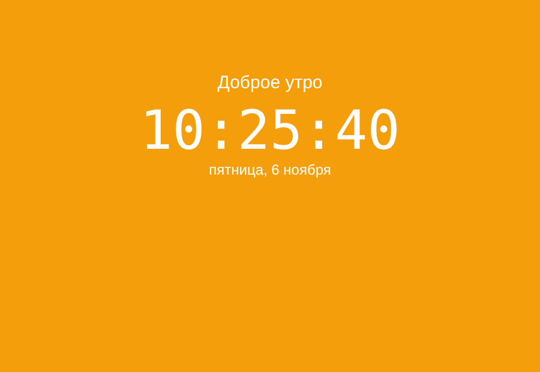

# Цифровые часы

Часы с датой, у которых фон и приветствие меняются в зависимости от времени суток.

Демо: https://mustafamashhady2.github.io/digital-clock/

## Задача
Сделать часы, которые обновляются каждую секунду и меняют оформление утром, днём, вечером и ночью.

## Что сделано
- время обновляется каждую секунду через `setInterval`
- функция добавляет ноль спереди, чтобы время выглядело как 09:05:03
- дата выводится на русском языке
- с помощью условий `if / else` меняются цвет фона и приветствие

## Инструменты
HTML, CSS, JavaScript

## Контекст
Учебный проект, делал один.
